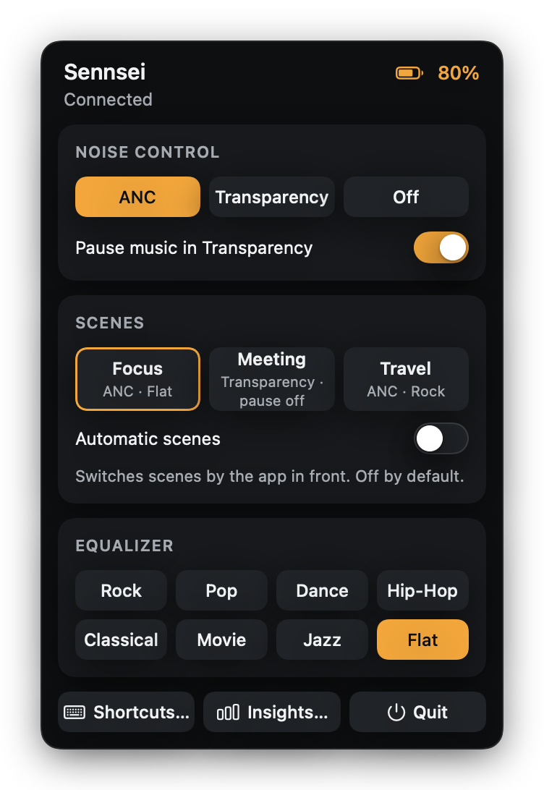
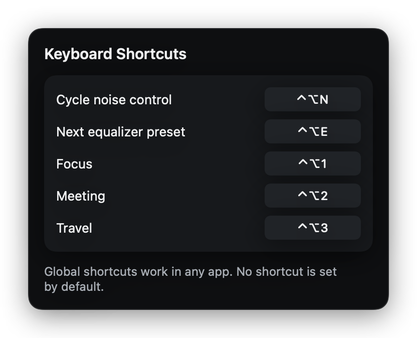
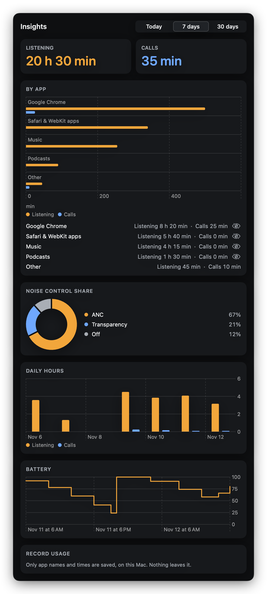

<p align="center">
  
</p>

<h1 align="center">Sennsei</h1>

<p align="center">
  <b>Noise control, equalizer presets and scenes for Sennheiser ACCENTUM headphones, from your Mac's menu bar.</b><br>
  A command line, global shortcuts, Shortcuts actions and local listening statistics. No account, no network.
</p>

```sh
brew install --cask onlyilkr/tap/sennsei
```

<sub>Available once the first release is published; until then see [Install](#install).</sub>

<p align="center">
  <a href="https://github.com/onlyilkr/sennsei/actions/workflows/ci.yml"></a>
  <a href="https://github.com/onlyilkr/sennsei/releases"></a>
  
  
  <a href="LICENSE"></a>
</p>

> [!IMPORTANT]
> **Unofficial. Not affiliated with, endorsed by or supported by Sennheiser or Sonova.** The Sennheiser and
> ACCENTUM names are used only to identify the compatible product. The icon and logo are original.
> Sennsei talks to the headphones over the same Bluetooth control channel the official phone app uses. It
> was built from observing that channel, from the Qualcomm GAIA framing and from third-party protocol notes
> (see [Credits](#credits)), and contains no code, files or data from the official app.

<p align="center">
  
</p>

<sub>The images in this README are generated from sample data (`make preview`). The switch, segmented picker
and shortcut recorder in them are look-alikes drawn for the screenshot.</sub>

## Contents

- [Why](#why)
- [How it works](#how-it-works)
- [Features](#features)
- [Install](#install)
- [Quick start](#quick-start)
- [The panel](#the-panel)
- [Noise control](#noise-control)
- [Equalizer](#equalizer)
- [Scenes](#scenes)
- [Command line](#command-line)
- [Shortcuts app](#shortcuts-app)
- [Global shortcuts](#global-shortcuts)
- [Insights](#insights)
- [Safety and privacy](#safety-and-privacy)
- [Supported devices](#supported-devices)
- [Limitations](#limitations)
- [Troubleshooting](#troubleshooting)
- [Uninstall](#uninstall)
- [Development](#development)
- [Credits](#credits)

More: [Protocol notes](docs/PROTOCOL.md) · [Architecture](docs/ARCHITECTURE.md) ·
[Contributing](CONTRIBUTING.md) · [Security](SECURITY.md) · [Changelog](CHANGELOG.md) ·
[Releasing](RELEASING.md)

## Why

The settings of these headphones live in a phone app. If you work at a Mac, switching between noise
cancelling and transparency means reaching for the phone. Sennsei puts those controls in the menu bar and
adds what the phone app does not have: scenes that switch with the app you are using, a command line, global
keyboard shortcuts, Shortcuts actions and a local picture of how you use the headphones.

## How it works

The headphones expose a Qualcomm GAIA v3 control channel over Bluetooth Classic (RFCOMM). Sennsei finds that
channel through the headphones' SDP records, by service UUID only, and sends short binary frames: read the
battery, read and set the noise control switches, write equalizer gains. Every frame passes one gate that
knows which commands exist, which are forbidden and which firmware they need, before a byte is sent. Details
are in [docs/PROTOCOL.md](docs/PROTOCOL.md).

The `sennsei` command line does not touch Bluetooth. It talks to the running app over a local socket, because
macOS grants the Bluetooth permission to an app, not to a shell.

## Features

- **Noise control**: ANC, Transparency or Off, and "Pause music in Transparency".
- **Equalizer presets**: Rock, Pop, Dance, Hip-Hop, Classical, Movie, Jazz, Flat (on firmware that supports
  the older equalizer, see [Equalizer](#equalizer)).
- **Battery** in the menu bar and the panel.
- **Scenes**: bundles of noise mode, pause setting and equalizer preset, applied by hand or, if you turn it
  on, automatically when a chosen app comes to the front.
- **Command line**: `sennsei noise anc`, `sennsei eq Jazz`, `sennsei status --json` and more.
- **Global keyboard shortcuts** for cycling noise control, the next equalizer preset and each scene.
- **Shortcuts app actions**: Apply Scene, Set Noise Control, Set Equalizer Preset, Get Battery Level.
- **Insights**: listening and call time per app, noise control share, daily hours and battery, kept on this
  Mac only.
- English and Turkish interface.

## Install

Sennsei needs **macOS 14 (Sonoma) or later**. It has been verified only on macOS 26 on Apple silicon.

**Homebrew** (becomes available with the first release; it is not published yet):

```sh
brew install --cask onlyilkr/tap/sennsei
```

The cask installs `Sennsei.app` and links the command line tool as `sennsei`. It also clears the quarantine
flag (see below).

**GitHub Releases**: download `Sennsei-<version>.zip` from the
[releases page](https://github.com/onlyilkr/sennsei/releases), unzip it and move `Sennsei.app` to
`/Applications`. The release also lists SHA-256 checksums.

**From source**: you need a Mac with Xcode installed (the Command Line Tools alone are not enough: the build
uses Xcode's `appintentsmetadataprocessor`, which produces the Shortcuts actions).

```sh
git clone https://github.com/onlyilkr/sennsei.git
cd sennsei
make app          # builds build/Sennsei.app and build/sennsei
open build/Sennsei.app
```

`make app` builds for your Mac's architecture. Release builds are universal.

> [!NOTE]
> **Universal binary. The Intel (x86_64) slice is built but has not been tested on an Intel Mac; please report problems.**

**First launch.** Sennsei is signed ad hoc and not notarized (there is no paid Developer ID behind it), so
Gatekeeper refuses a plain double-click on a downloaded copy. Right-click `Sennsei.app`, choose **Open**,
then **Open** again. A Homebrew install clears the quarantine flag for you; by hand, that is
`xattr -dr com.apple.quarantine /Applications/Sennsei.app`.

**The Bluetooth permission is asked again after every update or rebuild.** macOS ties it to the app's
signature, and an ad-hoc signature changes with every build. Until you allow it under System Settings >
Privacy & Security > Bluetooth, the app cannot connect.

## Quick start

1. Pair the headphones with your Mac and connect them (Sennsei does not connect them for you).
2. Start Sennsei. A headphone icon with the battery level appears in the menu bar, and macOS asks for
   Bluetooth permission the first time.
3. Click the icon. Pick ANC, Transparency or Off.
4. Optional: in a terminal, `sennsei status`.

Renamed headphones, or none at hand? See *The headphones have another name* and *Demo mode* in
[Troubleshooting](#troubleshooting).

## The panel

Click the menu bar icon.

- **Header**: connection state and battery.
- **Noise control**: ANC, Transparency, Off, and the *Pause music in Transparency* switch (the headphones'
  own setting).
- **Scenes**: Focus, Meeting and Travel by default, and the *Automatic scenes* switch (off by default).
- **Equalizer**: eight presets. When the equalizer cannot be used right now, the panel says why.
- **Shortcuts...** opens the keyboard shortcuts window, **Insights...** the statistics window, **Quit** quits.
  If the link drops, **Reconnect** appears.

The panel always shows what the headphones report, not what was last requested. If you change something with
the headphones' button or the phone app, the panel catches up on the next refresh.

## Noise control

ANC, Transparency and Off map to the headphones' two noise switches. Transparency wins if it is on. Turning
Transparency on makes these headphones pause the music by default; the panel's *Pause music in Transparency*
switch changes that setting on the headphones. Before every change Sennsei reads the current state and writes
nothing if the headphones already match. Details of the observed behaviour are in
[docs/PROTOCOL.md](docs/PROTOCOL.md#noise-control-model).

## Equalizer

Eight presets, applied as five band gains (50, 250, 800, 3000 and 8000 Hz, within plus or minus 6 dB).
Sennsei highlights a preset only while the gains read back from the headphones match it. There is no band
editor yet.

| Firmware | Equalizer in Sennsei |
| --- | --- |
| below 2.12.0 | not available |
| 2.12.0 up to, not including, 3.16.4 | works ("Gen1"; verified on 3.12.14) |
| 3.16.4 and later | **not implemented**: see the Gen2 equalizer [issue #1](https://github.com/onlyilkr/sennsei/issues/1) |

The Gen1 equalizer encoding follows protocol facts from the unlicensed xndbogdan/sennheiser-control notes (facts
only, no code or data copied) and was verified on an ACCENTUM Wireless SE by reading the settings back from the
headphones.

Two more conditions: the headphones must be in the Equalizer audio mode (switch it in the Sennheiser Smart
Control Plus app; Sennsei does not change the audio mode itself), and the model must be one Sennsei may
write to. Raising a band lowers the overall level a little, by design of the headphones' own equalizer. Updating the
firmware is the official app's job; keep in mind that newer firmware is Gen2, which Sennsei cannot write yet.

## Scenes

A scene is a named bundle of up to three settings. **A scene can only change the noise mode, "pause music in
Transparency" and the equalizer preset**, nothing else. Three scenes exist by default:

| Scene | Noise mode | Pause in Transparency | Equalizer |
| --- | --- | --- | --- |
| `focus` | ANC | unchanged | Flat |
| `meeting` | Transparency | off | unchanged |
| `travel` | ANC | unchanged | Rock |

Click a scene in the panel, run `sennsei scene focus`, press its shortcut, or run it from Shortcuts.

### scenes.json

Scenes live in `~/Library/Application Support/Sennsei/scenes.json`, a JSON array. **There is no scene editor
yet: you edit the file by hand** and restart Sennsei. The file is never written by the app, and Sennsei never
overwrites it. If the file is missing, the defaults are used. If it is invalid, the defaults are used and the
file is left as it is, so a typo cannot destroy your scenes.

```json
[
  {
    "id": "call",
    "name": "Call",
    "noiseMode": "transparency",
    "pauseInTransparency": false,
    "triggers": [
      { "kind": "frontApp", "bundleID": "us.zoom.xos" }
    ]
  },
  {
    "id": "write",
    "name": "Write",
    "noiseMode": "anc",
    "eqPreset": "Flat",
    "triggers": []
  }
]
```

| Key | Meaning |
| --- | --- |
| `id` | Required. What you type in `sennsei scene <id>`. |
| `name` | Required. Shown in the panel for your own scenes. |
| `noiseMode` | Optional: exactly `"anc"`, `"transparency"` or `"off"` (lowercase). Anything else is ignored. |
| `pauseInTransparency` | Optional: `true` or `false`. |
| `eqPreset` | Optional: a preset name, spelled exactly as in the panel (`Rock`, `Pop`, `Dance`, `Hip-Hop`, `Classical`, `Movie`, `Jazz`, `Flat`). |
| `triggers` | Optional list. The only kind today is `{ "kind": "frontApp", "bundleID": "..." }`. A trigger of an unknown kind is skipped. |

A file with your own scenes replaces the defaults; copy the ones you want to keep. The first scene whose
trigger matches the front app wins. A bundle id is what `osascript -e 'id of app "Safari"'` prints
(`com.apple.Safari`).

### Automatic scenes

Switch on **Automatic scenes** in the panel (or `sennsei auto on`). **It is off by default.** Then:

- Turning it on writes nothing by itself.
- When an app with a matching trigger comes to the front (after a short pause of 1.5 s so that quick
  app-switching does not flap), the scene is applied. Sennsei remembers the values it changed, and when you
  leave that app it puts back only those values.
- **A manual action pauses automatic scenes for the current app.** If you change noise control, equalizer or
  a scene yourself while an app is in front, its trigger stays quiet until you switch to another app.
- If an equalizer step cannot run right now, only that step is skipped.
- If the connection to the headphones drops, nothing applied before the drop is restored afterwards.

## Command line

The tool talks to the running app, so start Sennsei first. It is `build/sennsei` after `make app`, inside the
app at `Sennsei.app/Contents/Resources/sennsei`, and `sennsei` on your PATH after a Homebrew install.

```text
sennsei noise <anc|transparency|off|next>   Set or cycle the noise control mode
sennsei anc <on|off>                        Shortcut: on = noise anc, off = noise off
sennsei pause <on|off>                      Pause playback in Transparency mode
sennsei eq <preset|next>                    Select an equalizer preset (quote names with spaces)
sennsei scene <id>                          Activate a scene
sennsei auto <on|off>                       Turn automatic scenes on or off
sennsei status [--json]                     Show the headset state (--json prints the raw reply)
sennsei battery                             Print the battery percentage, or "unknown"
sennsei doctor                              Check the connection to the Sennsei app
sennsei --help                              Show this help
sennsei --version                           Show the version
```

Examples:

```sh
sennsei noise transparency
sennsei eq Jazz
sennsei scene focus
sennsei status --json | jq .status.battery
```

| Exit code | Meaning |
| --- | --- |
| 0 | success |
| 1 | the command failed |
| 2 | usage error |
| 3 | Sennsei is not running |
| 4 | timed out |

Results go to stdout and errors to stderr. Preset names and scene ids are not case sensitive on the command
line. `sennsei doctor` is read-only and prints one line each for the socket, the app, the versions, the
headphones' connection and the battery.

The control socket is `~/Library/Application Support/Sennsei/control.sock`. It is mode `0600` in a `0700`
directory, and the app accepts only connections from your own user (peer uid check). The command set is
fixed: there is no way to send a raw frame through it.

## Shortcuts app

Sennsei adds four actions to the Shortcuts app:

| Action | Parameter |
| --- | --- |
| Apply Scene | scene id as free text (`focus`, `meeting`, ...); returns a warning text if a step was skipped (for example "Equalizer skipped"), otherwise an empty text |
| Set Noise Control | Noise Cancelling, Transparency, Off |
| Set Equalizer Preset | preset name as free text (`Flat`, `Rock`, ...) |
| Get Battery Level | returns the percentage |

The scene and preset parameters are free text, not pick lists. Each action launches Sennsei if it is not
running and waits up to a few seconds for the headphones to connect; if they do not connect, nothing is
sent. The first time, the actions may not appear in Shortcuts until Sennsei has been launched once.

## Global shortcuts

Open **Shortcuts...** in the panel (Sennsei's own window, not the Shortcuts app) and record a
key combination for **Cycle noise control**, **Next equalizer preset**, and each scene. **No shortcut is set
by default.** They work in any app (the `KeyboardShortcuts` library 2.4.0, Carbon based, so no accessibility
permission is needed). A press is dropped, not queued, while an earlier action is still running. A shortcut
takes the same path and the same checks as the command line.

<p align="center">
  
</p>

## Insights

<p align="center">
  
</p>

Insights answers "how long did I listen, and to what". It is **on by default**; switch it off in the
Insights window, under *Record usage*.

**What is stored**, in `~/Library/Application Support/Sennsei/insights.sqlite` (file mode `0600`, folder
`0700`):

- the app's bundle id and display name, the audio route (Bluetooth or USB), start and end times, and the noise
  control mode at the time;
- noise mode durations and battery readings.

**What is not stored**: window titles, URLs, file names, content, or anything about sound that does not go to
the headphones. Nothing leaves your Mac.

How it counts:

- Only audio **routed to the headphones** (the output side) counts. Sound played through the Mac's
  speakers does not.
- A process that plays audio is **Listening**; a process that plays audio and also has the microphone open is
  a **Call**. Listening and call time are separate, so a call and music in the same app can overlap.
- Helper processes are counted under their app. Safari's audio helper shows as **Safari & WebKit apps**;
  system audio daemons that are not apps show as **System sounds**.
- While the control link to the headphones is down, recording pauses. Time while Sennsei is not running is not
  recorded (macOS keeps no history).
- Raw records are kept 90 days, then folded into daily summaries kept 12 months.
- The per-app audio information needs **macOS 14.2 or later**. On macOS 14.0 and 14.1 the window shows a
  notice and only noise mode and battery are recorded.

You are in control: **Record usage** switches recording off (nothing is read or written while it is off);
the eye icon next to an app, or *Exclude from recording*, leaves that app out; **Delete history** removes
everything after a confirmation; **Export CSV...** writes the raw activity rows
(`start,end,app,app_name,kind,route,noise_mode`) through a save panel. Fields that a spreadsheet could take
for a formula are prefixed with an apostrophe.

## Safety and privacy

**What Sennsei writes to the headphones.** The settings it changes are the noise control switches, the
"pause music in Transparency" setting and the equalizer (on supported firmware), and nothing else.

- Every outgoing frame passes `CommandCatalog`: a deny-list of destructive commands (factory reset,
  pairing deletion, firmware update and others), firmware gates, a payload check, and a check that the
  model is one Sennsei may write to before the first write.
- **Nothing is written when the app connects, polls or reconnects.** Those are reads.
- Each real write is an explicit user action: a click in the panel, a command line call, a global shortcut, a
  Shortcuts action, or a scene (including an automatic scene, which you must switch on; it is off by default).
- The app never sends the audio mode command (`0803`). See
  [docs/PROTOCOL.md](docs/PROTOCOL.md#why-0803-audio-mode-is-not-sent).
- **Sennsei never flashes firmware.** The official update path is the Sennheiser Smart Control Plus app.

**What stays on your Mac.** The app makes no network requests: no update check, no analytics, no
crash reporting. It runs no shell commands. Everything it stores is in
`~/Library/Application Support/Sennsei` (files `0600`) and in the `io.github.onlyilkr.sennsei` defaults
domain. [SECURITY.md](SECURITY.md) lists everything the app touches and how to report a problem privately.

## Supported devices

| Device | Status |
| --- | --- |
| **ACCENTUM Wireless SE, firmware 3.12.14, macOS 26 (Apple silicon)** | verified on hardware: noise control, the pause setting, battery, Gen1 equalizer, manual and automatic scenes, `noise`/`status`/`doctor` from the command line, one global shortcut (cycle noise control), Insights (headphone audio per app); the other CLI commands and the Shortcuts actions other than Get Battery Level were tested against the simulator only |
| Other ACCENTUM Wireless variants | treated as the same model (same model id prefix); **not verified** |
| ACCENTUM Plus, MOMENTUM 4 | recognised, **read-only**, untested |
| Any other Sennheiser model | read-only or not recognised; **untested** |

Nothing else is verified. If you have another Sennheiser (or Qualcomm GAIA) headphone, a read-only probe
run helps: see [CONTRIBUTING.md](CONTRIBUTING.md#device-reports) and the
[device report](https://github.com/onlyilkr/sennsei/issues/new?template=device_report.yml) issue template: paste what the script printed and the contents of the log file (attach it if long), after
redaction.
Verified on a single pair of headphones means exactly that: other firmware versions may behave differently.

## Limitations

- **Gen2 equalizer** (firmware 3.16.4 and later) cannot be written yet; see the Gen2 equalizer
  [issue #1](https://github.com/onlyilkr/sennsei/issues/1).
- **Ad-hoc signing, not notarized**: the first launch needs right-click Open, and the Bluetooth permission is
  asked again after every update.
- **Intel is untested**: the x86_64 slice is built, nothing more is known.
- **No scene editor**: scenes are edited by hand in `scenes.json`; there are no triggers other than the front
  app.
- **The audio mode is not changed by Sennsei**; the equalizer needs the Equalizer mode to be set already.
- **No automatic reconnect**: if the link drops, the panel shows it and you press *Reconnect*. Recording in
  Insights stops while the link is down.
- **Insights names**: audio from daemons that are not apps shows as system names ("System sounds").
- **Calls**: a call is counted when a process both plays to the headphones and has the microphone open;
  microphone-only use has not been verified on hardware.
- **Not built yet**: a widget, Focus filters, sleep and wake handling, a band-by-band equalizer, wind noise
  and the other settings of the official app (sidetone, auto power-off, voice prompts, paired devices).
- Only one pair of headphones, found by its paired name, is supported at a time.

## Troubleshooting

**The app says it cannot connect.** Check that the headphones are connected to this Mac (not only paired) and
that Sennsei is allowed under System Settings > Privacy & Security > Bluetooth. After an update or rebuild,
allow it again. Then press *Reconnect*. If another app holds the control channel, close it.

**`sennsei status` exits with 3.** The app is not running. Start it.

**`sennsei doctor`** prints a line each for the socket, the app, the versions, the headphones and the
battery, and exits 1 if one of them failed. Paste its output into a bug report.

**The headphones have another name.** The app looks for a paired device named `ACCENTUM`. Start it with another
name: `open --env SENNSEI_DEVICE_NAME="My Headphones" /Applications/Sennsei.app` (`open` does not pass your
shell's environment to the app).

**Quitting.** Use **Quit** in the panel. The app writes the open Insights records and closes the socket while
quitting. A hard kill (`kill -9`, `pkill`) leaves a stale socket, which the next launch cleans up, and skips
that final Insights flush. Quitting by the Dock goes through the same path (tested through an AppleEvent);
Cmd+Q by hand is not verified.

**The equalizer is greyed out.** The panel says why: firmware, audio mode, or read-only model.

**Demo mode.** `open --env SENNSEI_DEMO=1 build/Sennsei.app` uses simulated headphones.

**Reset everything.** Quit Sennsei, then:

```sh
defaults delete io.github.onlyilkr.sennsei
rm -rf ~/Library/Application\ Support/Sennsei
```

## Uninstall

Quit Sennsei, then remove it: `brew uninstall --cask sennsei` for a Homebrew install (`--zap` also removes the
data below), or delete `Sennsei.app` by hand. Data it left behind:

- `~/Library/Application Support/Sennsei` (scenes, the Insights database, the socket, probe logs)
- the defaults domain `io.github.onlyilkr.sennsei` (`defaults delete io.github.onlyilkr.sennsei`)
- the Bluetooth permission entry, in System Settings > Privacy & Security > Bluetooth

## Development

You need Xcode and macOS 14 or later. No hardware is needed for the tests.

```sh
make check    # unit tests, release build of the app, command line smoke test
make docs     # the README and documentation checks (needs make check's build first)
make app      # build/Sennsei.app and build/sennsei
make preview  # regenerate the README images from sample data
make dist VERSION=1.2.3   # release zip, checksums and cask in dist/ (nothing is published)
```

Layout: `Packages/HeadsetKit` is a Swift 6 package with the protocol, headset kit, app core, control socket,
CLI and the app itself; `Tools/` has the app bundler, the probe runner and the icon generator; `Fixtures/`
holds recorded frames and EQ results (device-identifying bytes masked); `docs/` the notes and images. See
[docs/ARCHITECTURE.md](docs/ARCHITECTURE.md) for how the parts fit. The tests use a simulated headset and
never touch Bluetooth.

`SennseiProbe` is a probe that, in its default mode, only reads: it records frames from a headset to a log. It is how
the fixtures were made and how a device report is collected. How to run it is in [CONTRIBUTING.md](CONTRIBUTING.md#device-reports).

## Credits

Sennsei was designed after reading about twenty open source projects for Sennheiser, Sony and other Bluetooth
headphones. Ideas and prior art only: no code from any of them was copied. Thanks to:

- [xndbogdan/sennheiser-control](https://github.com/xndbogdan/sennheiser-control): the protocol notes and
  ACCENTUM constants behind the Gen1 equalizer encoding (facts only; that project has no licence), and the
  transport/simulator split and capability profiles.
- [agrmohit](https://github.com/agrmohit) and [Ariazonaa](https://github.com/Ariazonaa): the command allow-list,
  deny-list and firmware gates with a model check before the first write. agrmohit also for finding the channel
  by UUID and ordering per command; Ariazonaa also for sending command line requests through the running app.
- [Oein](https://github.com/Oein): capability profiles per model and firmware, and finding the channel by UUID.
- [andr3-santos](https://github.com/andr3-santos): connection etiquette (do not wake the link without a user
  action) and the battery in the menu bar.
- [jvalaj](https://github.com/jvalaj) and [ADCDS](https://github.com/ADCDS): USB-C awareness and the audio route.
- [DanSmith888](https://github.com/DanSmith888): the `doctor` command.
- [Zhengyang-Liu](https://github.com/Zhengyang-Liu): the widget and update ideas (not built yet).

[KeyboardShortcuts](https://github.com/sindresorhus/KeyboardShortcuts) by Sindre Sorhus (MIT) provides the
shortcut recorder and global hotkeys.

Sennsei is released under the [MIT license](LICENSE). It is an independent project and has no connection to
Sennheiser or Sonova.
